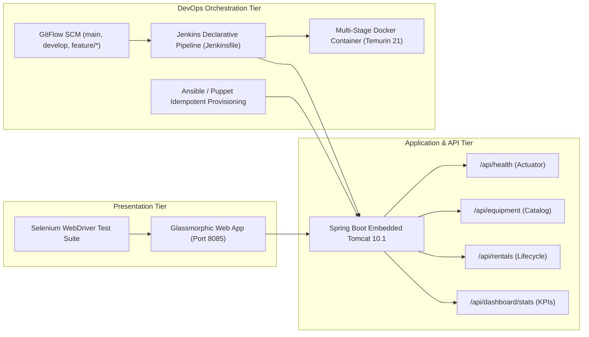

# 🚜 Dockerized Farm Equipment Rental System (AgriRent DevOps)

[](https://openjdk.org/)
[](https://maven.apache.org/)
[](https://spring.io/projects/spring-boot)
[](https://www.docker.com/)
[](https://www.jenkins.io/)
[](https://www.selenium.dev/)
[](https://www.ansible.com/)
[](https://github.com/)

An enterprise-grade, DevOps-automated, containerized agricultural machinery rental system designed to connect smallholder farmers with equipment owners, optimize machinery utilization, and automate the entire rental reservation lifecycle.

---

## 📋 Comprehensive 15-Task DevOps Milestone Reports

| Milestone Task | Task Title & Focus Area | Formal Report Reference | Status |
| :---: | :--- | :--- | :---: |
| **TASK 01** | Problem Definition, Stakeholders & Scope | [`TASK_01_REPORT`](file:///c:/Users/Administrator/Documents/Devops_Proj/docs/reports/TASK_01_REPORT_Problem_Definition_and_Scope.md) | ✅ Complete |
| **TASK 02** | Agile Planning, Backlog & DevOps Lifecycle | [`TASK_02_REPORT`](file:///c:/Users/Administrator/Documents/Devops_Proj/docs/reports/TASK_02_REPORT_Agile_Planning_and_DevOps_Workflow.md) | ✅ Complete |
| **TASK 03** | SRS, Architecture & Technology Setup | [`TASK_03_REPORT`](file:///c:/Users/Administrator/Documents/Devops_Proj/docs/reports/TASK_03_REPORT_Requirements_Architecture_and_Technology_Setup.md) | ✅ Complete |
| **TASK 04** | Git Repository Initialization & Policy | [`TASK_04_REPORT`](file:///c:/Users/Administrator/Documents/Devops_Proj/docs/reports/TASK_04_REPORT_Git_and_GitHub_Repository_Initialization.md) | ✅ Complete |
| **TASK 05** | Feature 1 Development with Branching | [`TASK_05_REPORT`](file:///c:/Users/Administrator/Documents/Devops_Proj/docs/reports/TASK_05_REPORT_Feature_Development_with_Branching.md) | ✅ Complete |
| **TASK 06** | MVP Completion & Conflict Resolution | [`TASK_06_REPORT`](file:///c:/Users/Administrator/Documents/Devops_Proj/docs/reports/TASK_06_REPORT_MVP_Completion_and_Git_Collaboration.md) | ✅ Complete |
| **TASK 07** | Jenkins Installation & CI Freestyle Job | [`TASK_07_REPORT`](file:///c:/Users/Administrator/Documents/Devops_Proj/docs/reports/TASK_07_REPORT_Jenkins_Installation_and_Continuous_Integration_Job.md) | ✅ Complete |
| **TASK 08** | Pipeline as Code & Server Deployment | [`TASK_08_REPORT`](file:///c:/Users/Administrator/Documents/Devops_Proj/docs/reports/TASK_08_REPORT_Pipeline_as_Code_and_Server_Deployment.md) | ✅ Complete |
| **TASK 09** | Selenium WebDriver Test Suite & Screenshots | [`TASK_09_REPORT`](file:///c:/Users/Administrator/Documents/Devops_Proj/docs/reports/TASK_09_REPORT_Selenium_Test_Design_and_Local_Execution.md) | ✅ Complete |
| **TASK 10** | Continuous Testing & Quality Gate Defense | [`TASK_10_REPORT`](file:///c:/Users/Administrator/Documents/Devops_Proj/docs/reports/TASK_10_REPORT_Continuous_Testing_in_Jenkins.md) | ✅ Complete |
| **TASK 11** | Multi-Stage Dockerfile & Container Lifecycle | [`TASK_11_REPORT`](file:///c:/Users/Administrator/Documents/Devops_Proj/docs/reports/TASK_11_REPORT_Docker_Image_and_Container_Lifecycle.md) | ✅ Complete |
| **TASK 12** | Jenkins-Docker CD & Registry Publishing | [`TASK_12_REPORT`](file:///c:/Users/Administrator/Documents/Devops_Proj/docs/reports/TASK_12_REPORT_Jenkins_Docker_Continuous_Deployment.md) | ✅ Complete |
| **TASK 13** | Server Prerequisites & Ansible/Puppet IaC | [`TASK_13_REPORT`](file:///c:/Users/Administrator/Documents/Devops_Proj/docs/reports/TASK_13_REPORT_Configuration_Management_Script.md) | ✅ Complete |
| **TASK 14** | Automated Provisioning & Idempotency Drill | [`TASK_14_REPORT`](file:///c:/Users/Administrator/Documents/Devops_Proj/docs/reports/TASK_14_REPORT_Automated_Provisioning_and_Reliability_Validation.md) | ✅ Complete |
| **TASK 15** | Master Release Guide & Viva Examination | [`TASK_15_REPORT`](file:///c:/Users/Administrator/Documents/Devops_Proj/docs/reports/TASK_15_REPORT_Final_DevOps_Release_and_Viva_Guide.md) | ✅ Complete |

---

## 🏛️ System Architecture



---

## 🚀 Execution & Quick Start Guide

### 1. Build and Run Local Application
```powershell
# Compile and package application
mvn clean package -DskipTests=true

# Launch application on port 8085
java -jar target/farm-equipment-rental-1.0.0.jar --server.port=8085

# Access Live Web UI: http://localhost:8085
# Access Health Endpoint: http://localhost:8085/api/health
```

### 2. Run Automated Test Suites
```powershell
# Run Unit & Integration Tests (11 tests)
mvn test -Dtest=EquipmentServiceTest,RentalWorkflowServiceTest

# Run Headless Selenium WebDriver Browser Tests (5 tests)
mvn test -Dtest=FarmEquipmentRentalSeleniumTest

# Run Full Test Portfolio (16 tests)
mvn test
```

### 3. Jenkins CI/CD Pipeline
- **Freestyle Job:** `Farm-Equipment-Rental-CI` (configured via [`jenkins/job-config.xml`](file:///c:/Users/Administrator/Documents/Devops_Proj/jenkins/job-config.xml))
- **Pipeline Job:** `Farm-Equipment-Rental-Pipeline` (configured via [`Jenkinsfile`](file:///c:/Users/Administrator/Documents/Devops_Proj/Jenkinsfile))
- **Quality Gate:** Automated tests block deployment upon assertion failure (demonstrated in Task 10).

### 4. Docker Container Lifecycle
```powershell
# Build multi-stage image
docker build -t agrirent-app:1.0.0 -t agrirent-app:latest .

# Run container with port mapping
docker run -d --name agrirent-app -p 8090:8080 -e SPRING_PROFILES_ACTIVE=prod agrirent-app:1.0.0

# Execute automated container lifecycle manager
powershell -File scripts/docker-lifecycle-manager.ps1 -Action lifecycle-demo
```

### 5. Infrastructure as Code (Ansible & Puppet)
```powershell
# Run Ansible playbook provisioning
powershell -File scripts/run-ansible-provisioning.ps1

# Run Idempotency & Rollback Drill (0 changes on rerun)
powershell -File scripts/verify-idempotency-and-rollback.ps1
```

---

## 📂 Project Repository Structure

```text
Devops_Proj/
├── .gitignore                                   # Version control exclusions
├── .dockerignore                                # Container context exclusions
├── BRANCH_POLICY.md                             # GitFlow branching rules & standards
├── Dockerfile                                   # Multi-stage production container build
├── docker-compose.yml                           # Container orchestration definition
├── Jenkinsfile                                  # Declarative 8-stage Pipeline as Code
├── pom.xml                                      # Maven build configuration with Java 21 & Selenium
├── README.md                                    # Project documentation & master roadmap
├── ansible/                                     # Configuration management
│   ├── inventory.ini                            # Target host definitions
│   ├── playbook.yml                             # Server provisioning playbook
│   ├── provisioning-first-run.log               # First execution log evidence
│   └── idempotency-and-rollback-evidence.log    # Verified idempotency & rollback log
├── puppet/                                      # Puppet infrastructure as code
│   └── manifests/site.pp                        # Declarative Puppet site manifest
├── docs/                                        # Engineering reports & documentation
│   └── reports/
│       ├── TASK_01_REPORT_Problem_Definition_and_Scope.md
│       ├── TASK_02_REPORT_Agile_Planning_and_DevOps_Workflow.md
│       ├── TASK_03_REPORT_Requirements_Architecture_and_Technology_Setup.md
│       ├── TASK_04_REPORT_Git_and_GitHub_Repository_Initialization.md
│       ├── TASK_05_REPORT_Feature_Development_with_Branching.md
│       ├── TASK_06_REPORT_MVP_Completion_and_Git_Collaboration.md
│       ├── TASK_07_REPORT_Jenkins_Installation_and_Continuous_Integration_Job.md
│       ├── TASK_08_REPORT_Pipeline_as_Code_and_Server_Deployment.md
│       ├── TASK_09_REPORT_Selenium_Test_Design_and_Local_Execution.md
│       ├── TASK_10_REPORT_Continuous_Testing_in_Jenkins.md
│       ├── TASK_11_REPORT_Docker_Image_and_Container_Lifecycle.md
│       ├── TASK_12_REPORT_Jenkins_Docker_Continuous_Deployment.md
│       ├── TASK_13_REPORT_Configuration_Management_Script.md
│       ├── TASK_14_REPORT_Automated_Provisioning_and_Reliability_Validation.md
│       └── TASK_15_REPORT_Final_DevOps_Release_and_Viva_Guide.md
├── jenkins/                                     # Jenkins configuration & logs
│   ├── job-config.xml                           # Freestyle job XML specification
│   ├── pipeline-job-config.xml                  # Pipeline job XML specification
│   ├── build-237-console.log                    # Task 7 successful build log
│   ├── pipeline-build-2-console.log             # Task 8 deployment pipeline log
│   ├── pipeline-build-4-failure.log             # Task 10 failed quality gate evidence
│   ├── pipeline-build-5-success.log             # Task 10 corrected rerun log
│   └── pipeline-build-6-docker-cd.log           # Task 12 Docker CD log
├── scripts/                                     # Automation utility scripts
│   ├── docker-lifecycle-manager.ps1             # Docker lifecycle management suite
│   ├── run-ansible-provisioning.ps1             # Ansible provisioning execution runner
│   └── verify-idempotency-and-rollback.ps1      # Idempotency & disaster recovery test
├── src/                                         # Application source code
│   ├── main/
│   │   ├── java/com/agrirent/                   # Spring Boot application code
│   │   └── resources/
│   │       ├── application.properties           # Spring configuration
│   │       └── static/                          # Glassmorphic frontend (HTML/CSS/JS)
│   └── test/
│       └── java/com/agrirent/                   # Automated tests
│           ├── EquipmentServiceTest.java        # Inventory unit tests
│           ├── RentalWorkflowServiceTest.java   # Workflow unit tests
│           └── selenium/                        # Automated browser testing
│               ├── FarmEquipmentRentalSeleniumTest.java
│               └── ScreenshotOnFailureExtension.java
└── target/screenshots/                          # Automated test failure & journey captures
    ├── UJ1_Browse_Search_Success.png
    ├── UJ2_Register_Equipment_Success.png
    ├── UJ3_Rental_Reservation_Success.png
    ├── UJ4_Workflow_Transitions_Success.png
    ├── UJ5_Demonstrated_Failure_Screenshot_Mechanism.png
    └── UJ3_Rental_Reservation_FAILURE.png
```
