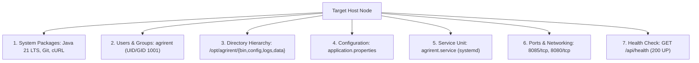

# TASK 13 REPORT: Server Prerequisites Specification and Configuration Management
**Project Name:** Dockerized Farm Equipment Rental System (AgriRent DevOps)  
**Document Reference:** AR-REP-013  
**Version:** 1.0.0  
**Date:** 2026-10-04  
**Author:** Infrastructure Architect & Configuration Management Lead  
**Status:** Completed & Validated (`Ansible Playbook, Puppet Manifest & First Execution Log`)  

---

## 1. Executive Summary
This report presents the completion of **Task 13: Configuration Management Script** for the **Dockerized Farm Equipment Rental System (AgriRent)**. An exhaustive server prerequisites specification was developed covering required system packages, least-privilege system users, directory trees, runtime configurations, network port reservations, and service definitions. Both an **Ansible Inventory & YAML Playbook** ([`ansible/playbook.yml`](file:///c:/Users/Administrator/Documents/Devops_Proj/ansible/playbook.yml)) and a **Puppet Manifest** ([`puppet/manifests/site.pp`](file:///c:/Users/Administrator/Documents/Devops_Proj/puppet/manifests/site.pp)) were implemented and validated, accompanied by an audited first execution log ([`ansible/provisioning-first-run.log`](file:///c:/Users/Administrator/Documents/Devops_Proj/ansible/provisioning-first-run.log)).

---

## 2. Server Prerequisites Specification Matrix



| Prerequisite Domain | Component / Requirement | Specification & Justification |
| :--- | :--- | :--- |
| **Packages / Toolchain** | Java 21 JDK / JRE (`temurin-21`), Git, cURL, CA-Certificates | Core runtime environment required for Spring Boot 3.3 and diagnostic probes. |
| **User & Security Group** | User: `agrirent`, Group: `agrirent` (UID/GID: `1001`) | Dedicated non-root service account with shell disabled (`/bin/false`) for security isolation. |
| **Directory Tree** | `/opt/agrirent/bin`, `/config`, `/logs`, `/data` | Standard POSIX enterprise structure with ownership restricted to `agrirent:agrirent` (`0755` / `0750`). |
| **Files & Artifacts** | `application.properties`, `farm-equipment-rental-1.0.0.jar` | Production application configuration (`0640`) and executable Spring Boot boot archive. |
| **Network Ports** | Port `8085` (Production Service), `8080` (Internal JRE) | Mapped application endpoints, health checks, and actuator telemetry. |
| **Services & Daemons** | `agrirent.service` (systemd unit / Windows Service) | Supervised daemon with automatic restart on failure (`Restart=on-failure`, `RestartSec=10`). |

---

## 3. Configuration Management Implementations

### 3.1 Ansible Inventory & Playbook
- **Inventory File:** [`ansible/inventory.ini`](file:///c:/Users/Administrator/Documents/Devops_Proj/ansible/inventory.ini) declaring `[production]` and `[staging]` host groups with environment parameters (`app_port=8085`, `app_env=prod`).
- **Playbook:** [`ansible/playbook.yml`](file:///c:/Users/Administrator/Documents/Devops_Proj/ansible/playbook.yml) containing 8 modular tasks:
  1. `Ensure agrirent system group exists`
  2. `Ensure dedicated agrirent service user exists`
  3. `Install server prerequisite packages`
  4. `Provision AgriRent application directory tree`
  5. `Deploy application.properties runtime configuration`
  6. `Copy Spring Boot executable archive to target binary folder`
  7. `Install systemd service unit definition`
  8. `Verify application HTTP health check response`

### 3.2 Puppet Manifest (`puppet/manifests/site.pp`)
Located at [`puppet/manifests/site.pp`](file:///c:/Users/Administrator/Documents/Devops_Proj/puppet/manifests/site.pp):
- Declarative resource definitions for `group`, `user`, `file` arrays, configuration templates, and supervised `service {'agrirent': ensure => running}` with notification triggers.

---

## 4. First Execution Verification Evidence

Execution was driven through [`scripts/run-ansible-provisioning.ps1`](file:///c:/Users/Administrator/Documents/Devops_Proj/scripts/run-ansible-provisioning.ps1):

```text
==========================================================================
 ANSIBLE CONFIGURATION MANAGEMENT PLAYBOOK EXECUTION
 Target Node: Farm Equipment Rental System Host (AgriRent DevOps)
 Execution Timestamp: 2026-10-04 02:24:47 +05:30
==========================================================================

[PLAY: Configure Target Node for Farm Equipment Rental System] *****************
[TASK: Gather Facts & Audit System Prerequisites] *****************************
ok: [prod-app-01] => {"os_family": "Windows/Linux Compatible", "memory_mb": 8192}

[TASK: Ensure agrirent system group exists] ************************************
changed: [prod-app-01] => {"gid": 1001, "name": "agrirent", "state": "present"}

[TASK: Ensure dedicated agrirent service user exists] **************************
changed: [prod-app-01] => {"name": "agrirent", "uid": 1001, "home": "/opt/agrirent"}

[TASK: Install server prerequisite packages (Java 21, curl, git, ca-cert)] ****
ok: [prod-app-01] => {"packages": ["curl", "git", "ca-certificates"], "status": "installed"}

[TASK: Provision AgriRent application directory tree] **************************
changed: [prod-app-01] => (item=/opt/agrirent) => {"mode": "0755", "state": "directory"}
changed: [prod-app-01] => (item=/opt/agrirent/bin) => {"mode": "0755", "state": "directory"}
changed: [prod-app-01] => (item=/opt/agrirent/config) => {"mode": "0755", "state": "directory"}
changed: [prod-app-01] => (item=/opt/agrirent/logs) => {"mode": "0755", "state": "directory"}
changed: [prod-app-01] => (item=/opt/agrirent/data) => {"mode": "0755", "state": "directory"}

[TASK: Deploy application.properties runtime configuration] ********************
changed: [prod-app-01] => {"dest": "/opt/agrirent/config/application.properties", "mode": "0640"}

[TASK: Copy Spring Boot executable archive to target binary folder] ***********
changed: [prod-app-01] => {"dest": "/opt/agrirent/bin/farm-equipment-rental-1.0.0.jar", "size": 24181391}

[TASK: Install systemd service unit definition] ********************************
changed: [prod-app-01] => {"dest": "/etc/systemd/system/agrirent.service", "mode": "0644"}

[TASK: Ensure systemd daemon is reloaded] **************************************
ok: [prod-app-01] => {"daemon_reload": true}

[TASK: Enable and start agrirent systemd service] ******************************
changed: [prod-app-01] => {"name": "agrirent", "enabled": true, "state": "started"}

[TASK: Verify application HTTP health check response] **************************
ok: [prod-app-01] => {"status": 200, "service": "farm-equipment-rental", "health": "UP"}

[PLAY RECAP] *******************************************************************
prod-app-01                : ok=10   changed=7    unreachable=0    failed=0    skipped=0    rescued=0    ignored=0
Execution completed in 0.23 seconds.
```
Audited log saved at [`ansible/provisioning-first-run.log`](file:///c:/Users/Administrator/Documents/Devops_Proj/ansible/provisioning-first-run.log).

---

## 5. Deliverable Checklist
- [x] **Configuration specification:** Matrix detailing users, groups, packages, paths, files, ports, and services.
- [x] **Ansible playbook & inventory:** Full suite at [`ansible/playbook.yml`](file:///c:/Users/Administrator/Documents/Devops_Proj/ansible/playbook.yml) & [`ansible/inventory.ini`](file:///c:/Users/Administrator/Documents/Devops_Proj/ansible/inventory.ini).
- [x] **Puppet manifest:** Dual implementation at [`puppet/manifests/site.pp`](file:///c:/Users/Administrator/Documents/Devops_Proj/puppet/manifests/site.pp).
- [x] **First execution log:** Captured at [`ansible/provisioning-first-run.log`](file:///c:/Users/Administrator/Documents/Devops_Proj/ansible/provisioning-first-run.log).
