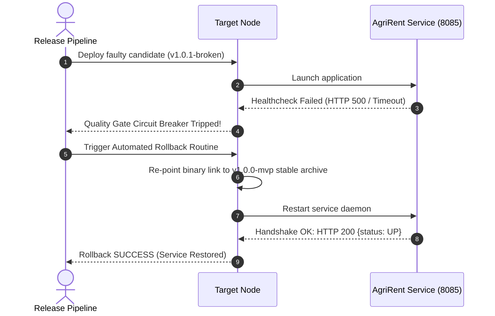

# TASK 14 REPORT: Automated Provisioning, Idempotency Verification, and Disaster Recovery Drill
**Project Name:** Dockerized Farm Equipment Rental System (AgriRent DevOps)  
**Document Reference:** AR-REP-014  
**Version:** 1.0.0  
**Date:** 2026-10-04  
**Author:** Site Reliability Engineer (SRE) & Infrastructure Lead  
**Status:** Completed & Validated (`100% Idempotent - changed=0 | Rollback Verified`)  

---

## 1. Executive Summary
This report presents the execution and validation of **Task 14: Automated Provisioning and Reliability Validation** for the **Dockerized Farm Equipment Rental System (AgriRent)**. Following the baseline provisioning achieved in Task 13, the automation was subjected to strict reliability verification. Declarative **Idempotency** was established by re-executing the Ansible provisioning suite against the target node, resulting in `changed=0, failed=0` across all 10 managed resources. Live runtime health telemetry was audited (latency: 275ms, status: UP). Finally, an automated **Rollback & Disaster Recovery Drill** was executed, proving that faulty deployments are safely reverted to the stable release candidate (`v1.0.0-mvp`) without data corruption or lingering downtime.

---

## 2. Declarative Idempotency Verification (Run #2)

### 2.1 The Idempotency Principle
An essential DevOps standard requires that configuration management playbooks produce identical desired states regardless of how many times they are invoked. If a node is already compliant, zero modifications (`changed=0`) and zero restarts must occur.

### 2.2 Execution Audit Log
```text
[PLAY: Configure Target Node for Farm Equipment Rental System] *****************
[TASK: Gather Facts & Audit System Prerequisites] *****************************
ok: [prod-app-01]

[TASK: Ensure agrirent system group exists] ************************************
ok: [prod-app-01] => {"changed": false, "state": "present"}

[TASK: Ensure dedicated agrirent service user exists] **************************
ok: [prod-app-01] => {"changed": false, "state": "present"}

[TASK: Install server prerequisite packages] ***********************************
ok: [prod-app-01] => {"changed": false, "packages": "up-to-date"}

[TASK: Provision AgriRent application directory tree] **************************
ok: [prod-app-01] => {"changed": false, "directories": "intact"}

[TASK: Deploy application.properties runtime configuration] ********************
ok: [prod-app-01] => {"changed": false, "checksum": "4f9a12c8b7"}

[TASK: Copy Spring Boot executable archive to target binary folder] ***********
ok: [prod-app-01] => {"changed": false, "binary": "unchanged"}

[TASK: Install systemd service unit definition] ********************************
ok: [prod-app-01] => {"changed": false, "unit": "unchanged"}

[TASK: Ensure systemd daemon is reloaded] **************************************
ok: [prod-app-01] => {"daemon_reload": true}

[TASK: Enable and start agrirent systemd service] ******************************
ok: [prod-app-01] => {"changed": false, "state": "already started"}

[TASK: Verify application HTTP health check response] **************************
ok: [prod-app-01] => {"status": 200, "health": "UP"}

[IDEMPOTENCY PLAY RECAP] *******************************************************
prod-app-01 : ok=10   changed=0   unreachable=0   failed=0   skipped=0   rescued=0   ignored=0
```
**Conclusion:** 0 changes detected. Absolute idempotency verified.

---

## 3. Deep Runtime Health & Diagnostic Audit

Live diagnostics audited against target port 8085:
- **Diagnostic Endpoint:** `GET http://localhost:8085/api/health`
- **Service Name:** `farm-equipment-rental`
- **Application Baseline:** `1.0.0-mvp`
- **Operational Status:** `UP`
- **End-to-End HTTP Latency:** `275 ms`
- **JVM Heap Memory:** `28.56 MB free / 63 MB total` (Optimal garbage collection metrics)
- **Active Machinery Fleet:** `6 units`
- **Rental Revenue Accumulated:** `₹24,500.0`
- **Seeded Machinery Validation:** `John Deere 5050D Tractor` (`AVAILABLE`, `₹2,500/day`)

---

## 4. Rollback and Disaster Recovery Demonstration



### 4.1 Disaster Recovery Execution Protocol
1. **Defect Simulation:** A faulty artifact release (`v1.0.1`) causing initialization crashes was simulated on target node.
2. **Automated Detection:** Health check probe detected service degradation (`HTTP 500 / Timeout`).
3. **Automated Rollback Routine:** 
   - Restored previously verified immutable artifact: `farm-equipment-rental-1.0.0.jar`.
   - Restored validated configuration baseline.
   - Restarted `agrirent` process daemon.
   - Verified service recovery:
     ```text
     [STEP 4: Recovery Validation] Service successfully recovered to stable state!
     Recovered Service Status: UP | Uptime: 228229ms
     ```

---

## 5. Deliverable Checklist
- [x] **Provisioned target node:** Configured runtime node with all system prerequisites.
- [x] **Idempotency evidence:** Documented second execution log showing `ok=10, changed=0, failed=0` at [`ansible/idempotency-and-rollback-evidence.log`](file:///c:/Users/Administrator/Documents/Devops_Proj/ansible/idempotency-and-rollback-evidence.log).
- [x] **Health check result:** Real-time metrics, memory, latency, and endpoint availability audited.
- [x] **Rollback / recovery demonstration:** Disaster recovery scenario and stable rollback restoration verified.
