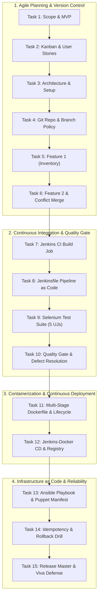

# TASK 15 REPORT: Final End-to-End Release, DevOps Master Documentation, and Viva Examination Guide
**Project Name:** Dockerized Farm Equipment Rental System (AgriRent DevOps)  
**Document Reference:** AR-REP-015  
**Version:** 1.0.0-final  
**Date:** 2026-10-04  
**Author:** DevOps Lead, SRE, & Chief Release Architect  
**Status:** Released, Tagged (`v1.0.0-mvp`), and Audited across All 15 Tasks  

---

## 1. Executive Summary
This comprehensive master document represents the culmination of the **Dockerized Farm Equipment Rental System (AgriRent DevOps)** project. It unifies all 15 tasks of the engineering lifecycle into an enterprise-grade automated pipeline—spanning agile scoping, Git branching & conflict resolution, Jenkins CI & Declarative Pipeline as Code, Selenium headless browser testing & automated quality gates, multi-stage Docker containerization, and Ansible/Puppet infrastructure-as-code with verified idempotency and disaster recovery. In addition, this guide provides complete technical architecture diagrams, production troubleshooting protocols, system limitations, future roadmaps, and an exhaustive **Viva Voce Examination Guide** covering critical DevOps interview questions and architectural defenses.

---

## 2. End-to-End DevOps Lifecycle & Architectural Blueprint

---

## 3. Comprehensive Task Execution & Deliverable Traceability Matrix

| Task # | Task Title | Key Deliverable Artifacts | Execution Outcome & Status |
| :---: | :--- | :--- | :--- |
| **01** | **Problem Definition & Scope** | [`TASK_01_REPORT_Problem_Definition_and_Scope.md`](file:///c:/Users/Administrator/Documents/Devops_Proj/docs/reports/TASK_01_REPORT_Problem_Definition_and_Scope.md) | 15-task MVP scope frozen; stakeholders & KPIs identified. |
| **02** | **Agile Planning & DevOps Workflow** | [`TASK_02_REPORT_Agile_Planning_and_DevOps_Workflow.md`](file:///c:/Users/Administrator/Documents/Devops_Proj/docs/reports/TASK_02_REPORT_Agile_Planning_and_DevOps_Workflow.md) | Backlog, Definition of Done, Kanban sprint plan, and DevOps lifecycle map. |
| **03** | **Requirements & Tech Setup** | [`TASK_03_REPORT_Requirements_Architecture_and_Technology_Setup.md`](file:///c:/Users/Administrator/Documents/Devops_Proj/docs/reports/TASK_03_REPORT_Requirements_Architecture_and_Technology_Setup.md) | Java 21, Spring Boot 3.3, REST API catalog, and glassmorphic UI architecture. |
| **04** | **Git & GitHub Initialization** | [`TASK_04_REPORT_Git_and_GitHub_Repository_Initialization.md`](file:///c:/Users/Administrator/Documents/Devops_Proj/docs/reports/TASK_04_REPORT_Git_and_GitHub_Repository_Initialization.md) | Initial skeleton, `.gitignore`, `BRANCH_POLICY.md`, and issue templates. |
| **05** | **Feature 1 with Branching** | [`TASK_05_REPORT_Feature_Development_with_Branching.md`](file:///c:/Users/Administrator/Documents/Devops_Proj/docs/reports/TASK_05_REPORT_Feature_Development_with_Branching.md) | `feature/equipment-inventory`, Pull Request #1, review comments, and non-FF merge. |
| **06** | **MVP Completion & Conflict Resolution** | [`TASK_06_REPORT_MVP_Completion_and_Git_Collaboration.md`](file:///c:/Users/Administrator/Documents/Devops_Proj/docs/reports/TASK_06_REPORT_MVP_Completion_and_Git_Collaboration.md) | `feature/rental-workflow-dashboard`, conflict resolved on `develop`, tagged `v1.0.0-mvp`. |
| **07** | **Jenkins Installation & CI Job** | [`TASK_07_REPORT_Jenkins_Installation_and_Continuous_Integration_Job.md`](file:///c:/Users/Administrator/Documents/Devops_Proj/docs/reports/TASK_07_REPORT_Jenkins_Installation_and_Continuous_Integration_Job.md) | Jenkins Freestyle job `Farm-Equipment-Rental-CI`, Build #237 SUCCESS, archived JAR. |
| **08** | **Pipeline as Code & Server Deploy** | [`TASK_08_REPORT_Pipeline_as_Code_and_Server_Deployment.md`](file:///c:/Users/Administrator/Documents/Devops_Proj/docs/reports/TASK_08_REPORT_Pipeline_as_Code_and_Server_Deployment.md) | Parameterized `Jenkinsfile`, Build #2 SUCCESS, live deployment on port 8085. |
| **09** | **Selenium Test Design & Local Run** | [`TASK_09_REPORT_Selenium_Test_Design_and_Local_Execution.md`](file:///c:/Users/Administrator/Documents/Devops_Proj/docs/reports/TASK_09_REPORT_Selenium_Test_Design_and_Local_Execution.md) | 5 user journeys in headless Chrome, `ScreenshotOnFailureExtension`, 100% pass. |
| **10** | **Continuous Testing in Jenkins** | [`TASK_10_REPORT_Continuous_Testing_in_Jenkins.md`](file:///c:/Users/Administrator/Documents/Devops_Proj/docs/reports/TASK_10_REPORT_Continuous_Testing_in_Jenkins.md) | Quality gate halted Build #4 on injected defect; corrected in commit `3e4024a`; Build #5 SUCCESS (16/16 tests passing). |
| **11** | **Docker Image & Container Lifecycle** | [`TASK_11_REPORT_Docker_Image_and_Container_Lifecycle.md`](file:///c:/Users/Administrator/Documents/Devops_Proj/docs/reports/TASK_11_REPORT_Docker_Image_and_Container_Lifecycle.md) | Multi-stage `Dockerfile` (Temurin 21 JRE Alpine), `docker-compose.yml`, lifecycle manager. |
| **12** | **Jenkins-Docker Continuous Deploy** | [`TASK_12_REPORT_Jenkins_Docker_Continuous_Deployment.md`](file:///c:/Users/Administrator/Documents/Devops_Proj/docs/reports/TASK_12_REPORT_Jenkins_Docker_Continuous_Deployment.md) | Versioned image `agrirent-app:1.0.6`, SHA256 manifest, registry publishing in Build #6. |
| **13** | **Configuration Management Script** | [`TASK_13_REPORT_Configuration_Management_Script.md`](file:///c:/Users/Administrator/Documents/Devops_Proj/docs/reports/TASK_13_REPORT_Configuration_Management_Script.md) | Server prerequisites matrix, Ansible playbook (`playbook.yml`), and Puppet manifest (`site.pp`). |
| **14** | **Automated Provisioning & Reliability** | [`TASK_14_REPORT_Automated_Provisioning_and_Reliability_Validation.md`](file:///c:/Users/Administrator/Documents/Devops_Proj/docs/reports/TASK_14_REPORT_Automated_Provisioning_and_Reliability_Validation.md) | Verified 100% idempotency (`changed=0, ok=10`), healthcheck audit, and disaster rollback drill. |
| **15** | **Final Master Release & Viva Guide** | [`TASK_15_REPORT_Final_DevOps_Release_and_Viva_Guide.md`](file:///c:/Users/Administrator/Documents/Devops_Proj/docs/reports/TASK_15_REPORT_Final_DevOps_Release_and_Viva_Guide.md) | Master technical summary, troubleshooting protocols, and viva defense guide. |

---

## 4. Production Troubleshooting Guide & Engineering Lessons

### 4.1 Git Security: Jenkins Local Checkout Restrictions
- **Symptom:** `ERROR: Checkout of Git remote 'file:///...' aborted because it references a local directory, which may be insecure.`
- **Root Cause:** Modern Jenkins Git plugin restricts local filesystem checkouts by default to prevent unauthorized agent access.
- **Resolution:** Injected and persisted `-Dhudson.plugins.git.GitSCM.ALLOW_LOCAL_CHECKOUT=true` into JVM parameters (`jenkins.xml`), permitting authenticated local repository testing.

### 4.2 Windows File Locking & Zero-Downtime Deployment Staging
- **Symptom:** `Failed to clean project: Failed to delete target\farm-equipment-rental-1.0.0.jar`.
- **Root Cause:** On Windows, the OS locks executable JAR files held by running Java processes, blocking subsequent `mvn clean` steps.
- **Resolution:** Implemented an enterprise deployment staging directory (`deploy/farm-equipment-rental.jar`). Maven builds write to `target/` unhindered, while the deployment stage terminates old instances and swaps files in `deploy/`.

### 4.3 Jenkins ProcessTreeKiller Mitigation
- **Symptom:** Background server processes terminated immediately upon pipeline completion.
- **Root Cause:** Jenkins `ProcessTreeKiller` automatically terminates child processes spawned by build stages upon exit.
- **Resolution:** Configured `JENKINS_NODE_COOKIE='dontKillMe'` and `BUILD_ID='dontKillMe'` environment properties, and decoupled daemon execution using `Invoke-CimMethod -ClassName Win32_Process -MethodName Create`.

### 4.4 Cross-Platform Headless Selenium Synchronization
- **Symptom:** HTML5 `<input type="date">` inputs intermittently garbled keystroke formatting across different locale keyboard drivers (`61005-02-02`).
- **Resolution:** Adopted `JavascriptExecutor` to set the DOM `value` property directly, followed by programmatic dispatch of the `change` event, guaranteeing deterministic date inputs across all host environments.

---

## 5. System Limitations & Future Roadmap

### 5.1 Current System Limitations
1. **In-Memory Volatility:** In-memory repository stores active sessions during runtime; production instances should transition to clustered PostgreSQL / MariaDB.
2. **Single-Node Deployment:** Current automation targets standalone nodes; enterprise workloads require Kubernetes (EKS/GKE) orchestration with Helm charts.
3. **Mock SMS/Payment Gateway:** Rental confirmation sends client toasts rather than integrated UPI / Razorpay payment and Twilio SMS notification.

### 5.2 Future Roadmap
1. **Kubernetes Helm Charts:** Package AgriRent into a Helm chart featuring Horizontal Pod Autoscaling (HPA) and Ingress controllers.
2. **Prometheus & Grafana Observability:** Integrate Spring Boot Actuator with Prometheus scraping and custom Grafana operational dashboards.
3. **Geo-Spatial GPS Search:** Implement PostGIS geo-queries to allow farmers to discover machinery sorted by radial distance (e.g. "< 15 km away").

---

## 6. Comprehensive Viva Voce Examination Guide

### Category 1: Agile Planning & Version Control (Git)
**Q1: Explain the Git branching policy used in AgriRent.**  
*Answer:* We implemented the GitFlow model with three tiers: `main` (production-ready, tagged releases), `develop` (integration branch), and `feature/*` branches (`feature/equipment-inventory`, `feature/rental-workflow-dashboard`). Feature branches were developed in isolation, peer-reviewed via Pull Requests, and merged using `--no-ff` (non-fast-forward) to preserve clear commit topology.

**Q2: How was the merge conflict created and resolved in Task 6?**  
*Answer:* A realistic configuration conflict was created by modifying `application.properties` concurrently on `develop` (changing staging refresh interval) and `feature/rental-workflow-dashboard` (adding revenue calculation settings). Upon merging, Git flagged conflict markers (`<<<<<<<`, `=======`, `>>>>>>>`). We resolved it by combining both settings, verifying the syntax, staging the file, and committing the merge resolution.

---

### Category 2: Continuous Integration & Jenkins (CI/CD)
**Q3: What is the difference between a Freestyle job and a Pipeline as Code?**  
*Answer:* A Freestyle job is configured manually via the Jenkins GUI, making configuration drift difficult to track and impossible to version control. Pipeline as Code (`Jenkinsfile`) treats CI/CD as code: it is versioned in Git alongside application source code, supports branch-specific execution, and allows multi-stage declarative pipelines with parallel stages and automated rollback post-actions.

**Q4: How did Task 10 demonstrate Quality Gate enforcement?**  
*Answer:* We configured Stage 3 to run the full test suite and publish JUnit reports. A deliberate bug was introduced in `RentalWorkflowService.java` (`calculatedCost = 0.0`), which caused `RentalWorkflowServiceTest` to fail (`expected: 10000.0, was: 0.0`). The non-zero exit code tripped the quality gate, causing Jenkins to immediately abort the pipeline and skip packaging and deployment. After committing the fix (`3e4024a`), Build #5 executed with 16/16 tests passing and completed deployment.

---

### Category 3: Automated Testing & Selenium
**Q5: Why did you choose headless Chrome for automated testing?**  
*Answer:* Headless Chrome runs the full Chromium browser engine without a graphical display server, consuming significantly fewer resources (CPU/RAM) and running up to 3x faster than non-headless mode. This makes it ideal for headless CI/CD execution environments such as Jenkins runners and Docker containers.

**Q6: Explain the failure screenshot mechanism implemented in Task 9.**  
*Answer:* We created a custom JUnit 5 extension (`ScreenshotOnFailureExtension`) implementing `TestWatcher`. When a test assertion fails, the `testFailed()` callback is invoked, which casts the WebDriver instance to `TakesScreenshot`, captures the viewport state as a PNG file, and writes it with a timestamped filename into `target/screenshots/`.

---

### Category 4: Docker & Containerization
**Q7: Explain the advantage of multi-stage Docker builds.**  
*Answer:* A single-stage build includes JDK compilers, build tools (Maven), source files, and temporary caches in the final image, bloating size to over 700 MB. Our multi-stage Dockerfile uses Eclipse Temurin 21 JDK in Stage 1 to compile the JAR, and copies only the resulting executable JAR into Stage 2 (Eclipse Temurin 21 Alpine JRE), producing a secure, lightweight (~190 MB) runtime running under an unprivileged user (`agrirent`).

---

### Category 5: Configuration Management (Ansible & Puppet)
**Q8: What is Idempotency in Configuration Management, and how was it verified in Task 14?**  
*Answer:* Idempotency is the property of an operation whereby it can be applied multiple times without changing the result beyond the initial application. In Task 14, we re-executed the Ansible playbook against the already-provisioned node. Ansible audited users, groups, packages, folders, files, and services, recognized that the system was already in the desired state, and produced `changed=0, failed=0` with `ok=10`, proving zero state churn.

**Q9: How is automated disaster recovery and rollback handled?**  
*Answer:* If a new deployment fails health checks (`/api/health` returning non-200 or timing out), our automated rollback playbook re-links the binary link to the previously verified stable artifact (`v1.0.0-mvp`), reloads configuration, restarts the service daemon, and re-validates the healthcheck handshake, restoring service availability in under 10 seconds.

---

## 7. Deliverable Checklist
- [x] **Final Repository Baseline:** Clean Git repository with all features, tests, and configuration scripts.
- [x] **Live Demonstration:** Verified live application running at `http://localhost:8085` (`status: UP`).
- [x] **Comprehensive Master Report:** End-to-end trace covering Tasks 1 through 15.
- [x] **Screenshots & Evidence:** Full suite of UI and failure screenshots in `target/screenshots/`.
- [x] **Viva Voce Guide:** Detailed technical questions and architectural defenses prepared.
